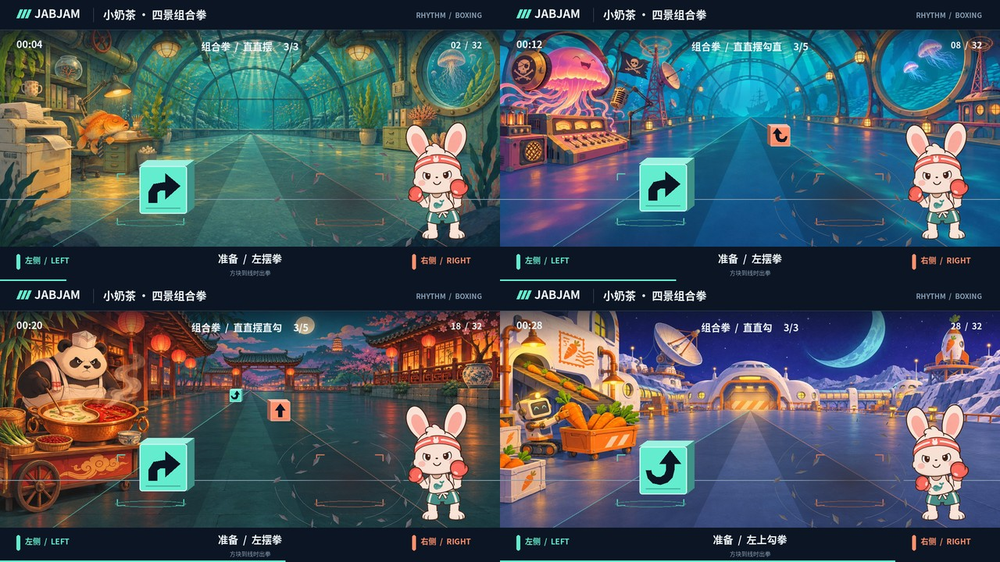

# JabJam · 音乐拳击跟练视频生成器

选一首本地歌曲，生成可以在手机、电脑或电视上反复播放的 MP4。跟练时面向屏幕，看方块沿左右轨道飞近，在它抵达击打线的音乐拍点空击。可以直接用播放器暂停和回放。

## 看懂八种动作

左右按跟练者面向屏幕时的方向判断。默认左轨青色、右轨橙色。

| 动作 | 左侧 JSON ID | 右侧 JSON ID | 看到什么、怎么跟 |
| --- | --- | --- | --- |
| 直拳 | `left_jab` | `right_jab` | 空中方块带直箭头，到线时用对应侧的手向前出拳。 |
| 摆拳 | `left_hook` | `right_hook` | 箭头朝画面中间横弯：左摆拳向右，右摆拳向左。 |
| 上勾拳 | `left_uppercut` | `right_uppercut` | J 形箭头从下向上挑，到线时跟着做上勾拳。 |
| 侧步 | `step_left` | `step_right` | 脚印沿地面靠近，按箭头向左或向右迈步，在拍点落脚。 |

## 在 GitHub Actions 生成视频

1. 打开 [Render follow-along MP4](https://github.com/CheeseAgent/jabjam/actions/workflows/render-video.yml)，点 **Run workflow**，选择含所需课程的分支。保留默认参数可以生成一段约 37 秒的原创音乐组合拳练习。
2. 想跟小奶茶练组合拳，课程填 `courses/milktea-tour.json`。在 **scene** 下拉框选整首歌的背景，选 `course` 会使用课程里指定的场景。表单也可调整歌名、难度、最短间隔和拍点偏移。
3. 运行成功后，在 **Summary** 点下载链接，解压播放 `jabjam.mp4`。压缩包保留 **7 天**，附上可编辑的 `jabjam-course.json` 和资源报告。自动课程还有 `jabjam.chart.json`，可对照实际拍点。

手动运行默认只导出并检查所选课程。勾选最后一项会附加四拳和八动作短片、抽帧对照图与三分钟压力测试。相关 PR 和合入 `main` 的改动会自动跑完整验收。构建后的排谱和编码在断网容器内完成。使用仓库中的音乐时，把下载的 JSON 放回同一版仓库的 `build/video/`，它就能按相对路径找到歌曲。

## 小奶茶的四个场景



| 场景 | 画面 | `--scene` 或 Actions 选项 |
| --- | --- | --- |
| 海底摸鱼办公室 | 金鱼趴在文件堆上，身后是海底玻璃穹顶 | `undersea-office` |
| 水母海盗电台 | 戴耳机的水母在海盗电台当 DJ | `jellyfish-radio` |
| 熊猫火锅夜市 | 熊猫掌勺，鸳鸯锅和灯笼亮在左边 | `panda-hotpot` |
| 月球萝卜基地 | 机器人把萝卜装车，远处停着萝卜火箭 | `moon-carrots` |

每首歌在渲染前选定背景。小奶茶示例课程默认用熊猫火锅夜市。把课程 JSON 的 `picture.scene` 设为表中任意选项，或在导出命令里用 `--scene` 指定本次场景。也可选 `neon` 或 `classic`。

```sh
python3 video/export.py courses/milktea-tour.json build/jellyfish-round.mp4 --scene jellyfish-radio
```

## 片头歌名、音乐音波和视频背景

三项默认关闭，可在 Actions 表单、课程 JSON 或命令行里独立选择。下表两行的风格可任意搭配。

| 效果 | 预设 |
| --- | --- |
| 片头歌名 `--title-style` | `cinema` 宽银幕金线淡入，`arcade` 街机斜牌滑入，`vinyl` 黑胶唱片封套 |
| 音乐音波 `--wave-style` | `ribbon` 双侧流光波纹，`bars` 镜面跳柱，`orbit` 一对声波光环 |

例如，给小奶茶的跟练片加一个黑胶片头，让音波随原曲起伏。

```sh
python3 video/export.py courses/milktea-tour.json build/vinyl.mp4 --title-style vinyl --wave-style ribbon
```

有自己的视频时，追加 `--background-video "素材/夜景.mp4"`。短片循环，长片播到歌曲结束，成片使用课程的音乐。三个选项都可以单独传 `off`。[课程字段与路径写法](docs/video-export.md#片头音波与视频背景)

## 自动谱怎样踩拍

自动模式从音频的低频和全频起音估算速度，再根据前后几拍的共同重音微调每个拍点。热身、组合拳和侧步共用这条时间轴。音乐的四秒能量窗口决定何处加密和留白。

导出生成的 `.chart.json` 记录原曲拍点 `source_beats`、最终动作 `notes`、BPM 和置信度。`beat_offset_ms` 可将按拍点安排的动作提前或延后最多 250 毫秒。视频里拳套到位、方块碎裂和拳序显示在离动作最近的同一帧。

## 难度、歌词与连击显示

Actions、课程 JSON 和命令行均可选择 Easy、Normal、Hard、Expert。Hard 的强段练六拳，Expert 的强段可达八拳。喂靶模式在换组前两拍报出左右手和下一套组合。短歌词可以两句共用一组，首拳踩句首，其余拳跟鼓点。

| 渲染选项 | 预设 |
| --- | --- |
| 歌词 `--lyrics` | `off` 关闭（默认），`fade` 淡入淡出，`rise` 上浮入场，`pulse` 随拍脉冲 |
| 连击 `--combo-style` | `minimal` 简洁计数，`arcade` 街机弹字（默认），`ring` 能量环 |
| 位置 `--combo-side` | `auto` 放在教练对面（默认），也可选 `left`、`right` 或 `off` |

用带原创示范文字的课程就能直接比较效果。

```sh
python3 video/export.py courses/lyrics-and-combos.json build/expert-ring.mp4 --difficulty expert --lyrics pulse --combo-style ring
```

## 固定组合拳练习（padwork）

经典连招现在由 [`video/padwork_combos.json`](video/padwork_combos.json) 维护，不用改 Python。`bands` 按训练强度列出每套连招的 `id`、`label` 和 `moves`（`jab` 直拳、`hook` 摆拳、`uppercut` 上勾拳），`section_bands` 指定 Normal/Hard/Expert 的递进组合，`chorus_finales` 定义副歌延长版。连招 ID 必须唯一；副歌延长版必须以原三拳开头。修改后运行 `python3 tests/test_video_pacing.py` 和完整回归。现有 18 套连招已原样迁入。


想让同一句副歌回来时练同一套动作，可以在课程的 `course.chorus_starts` 填它每次起唱的秒数。小奶茶会先左起教「直直摆」，再换右手，第三次及以后的最后一遍有空间就接成「直直摆勾直」。[37 秒示范课程](courses/chorus-signature.json) 在第 8、18、28 秒演示三次变化。[选择其他招牌组合与标记方法](docs/video-export.md#副歌招牌组合)

想让小奶茶跟着歌词起手，把逐行带时间的 `song.lrc` 放在 `song.mp3` 旁边，使用 Normal、Hard 或 Expert 的自动喂靶谱。歌手提前半拍开口，第一拳就跟着提前，第二拳起继续踩鼓点。相邻短句可以共用一组，收拳后在下一处合适的句首起手。也可以直接在课程里填写句首秒数。[歌词时间和示例](docs/video-export.md#按歌词起拳)

当音乐强度上升，拳组会从双拳热身过渡到常规三、四拳组合，再到五拳组合；每个级别都有多个经典套路，镜像重复练习两次后轮换。这是固定的训练乐句模板，不是每个拳点随机选动作，也不是已经实现真实歌曲的主副歌识别。视频会给出当前组合与第几拳的提示；Easy 自动练习不启用长组合。

## 导出入口

在装有 Godot 4.6.3 Standard、Python 3、Pillow、Noto CJK 字体、FFmpeg 和 ffprobe 的 Linux 环境中执行：

```sh
python3 video/export.py courses/neon-round.json build/neon-round.mp4 \
  --song-title "JabJam Demo Loop" --difficulty easy --min-gap 1.4
```

输出为横屏 H.264 / AAC MP4。音乐在本地分析；拳法、侧步、方块接近速度、配色、分辨率与帧率都由课程控制。课程字段、时间轴和测试口径见[视频导出指南](docs/video-export.md)。

## 从自动谱开始改

先让 JabJam 排一遍，把成片会用到的动作和时间写进普通课程 JSON。下面三条命令可在仓库根目录运行。第一条完成后，打开 `build/my-round.json`，在 `actions` 里换拳、删动作或挪动时间。

```sh
python3 video/export.py courses/neon-round.json --write-course build/my-round.json
python3 video/export.py build/my-round.json --check
python3 video/export.py build/my-round.json build/my-round.mp4
```

第一条会替换指定的目标 JSON，想保留手改版本时请另取文件名。自有歌曲仍从本地读取，生成的 JSON 会按新位置调整音乐路径。组合名和拳序也会写入谱面。第二条只需 Python 3.9+，会检查课程字段与手排间隔。实际音频时长在写谱或导出时核对。

## 写一份课程

**自动编排**时，把 `actions` 设为 `"auto"`。新增 `"movement_set": "padwork"`（搭配 Normal、Hard 或 Expert）：教练从经典组合库中轮换 **直直摆、直直勾、直摆直、直直摆直、直直摆勾直、直勾直摆直** 等十余套拳组。每个套路先左起手、再右起手镜像重复两次练熟，才换下一套；音乐强度控制难度分组，组合之间留恢复拍。画面会显示组合名和当前拳序。默认 [neon-round.json](courses/neon-round.json) 已切换为此模式；旧的 `classic`、`mixed` 均保留。详情见 [视频导出指南](docs/video-export.md)。

**手排**时，在 `actions` 数组里写清每个动作及其相对音乐开头的秒数。下面是一份可直接导出的课程，用内置音乐先练左摆拳和右上勾拳，再向左侧步、向右回位：

```json
{
  "version": 1,
  "course": {"music": "builtin:demo", "difficulty": "normal"},
  "actions": [
    {"time": 4.0, "action": "left_hook"},
    {"time": 6.0, "action": "right_uppercut"},
    {"time": 8.0, "action": "step_left"},
    {"time": 10.0, "action": "step_right"}
  ]
}
```

换歌时，把 `course.music` 改为相对这份 JSON 的 MP3、WAV 或 Ogg Vorbis 文件路径。想放慢节奏，可设置 `course.min_gap` 或在调用时传 `--min-gap`（秒）。导出器取用户设置和下表规则中的较大值。手排动作过密时，错误信息会指出要调整的两个时刻。

| 相邻动作的最短间隔 | Easy | Normal | Hard | Expert |
| --- | ---: | ---: | ---: | ---: |
| 一般出拳 | 1.10 秒 | 0.45 秒 | 0.38 秒 | 0.32 秒 |
| 摆拳或上勾拳之后，或连续使用同一只手 | 1.35 秒 | 0.90 秒 | 0.70 秒 | 0.50 秒 |
| 侧步之前和之后 | 1.75 秒 | 1.50 秒 | 1.40 秒 | 1.25 秒 |

## 接手代码时从哪里改

[仓库根目录的 AGENTS.md](AGENTS.md) 把改课程、调节奏、加组合和改画面分别对应到文件、函数和验收命令。详细的任务修改边界、验证命令和失败排查见 [小奶茶维护操作手册](docs/maintenance-playbook.md)。可以先运行 `python3 video/export.py courses/eight-moves.json --check`，确认能读出 8 个手排动作。

## 早期交互原型

Godot 互动工程仍可以独立运行。导出器直接复用它的导歌及编排实现，成片播放与动作计分彼此独立。[原型运行指南](docs/development.md) · [游戏设计历史](docs/game-design-vision.md) · [引擎选型记录](docs/decisions/0001-game-engine-godot.md)

## 🐰 小奶茶骨骼教练

[观看 24 秒跟练样片](docs/coach-preview/milktea-rig.mp4) · [角色近景](docs/coach-preview/milktea-motion-review.mp4) · [关键姿势](docs/coach-preview/key-poses.jpg) · [绑定与维护](docs/coach-avatar.md)

运行 `python3 video/export.py courses/coach-demo.json build/coach-demo.mp4` 即可生成带小奶茶的八动作跟练视频。在 Godot 4 中打开 `scenes/coach_demo.tscn`，按 F6 可单独观看教练。小奶茶使用同一套独立 PNG、关节与动作曲线。旧课程可继续使用已有的逐帧皮肤或矢量教练。
